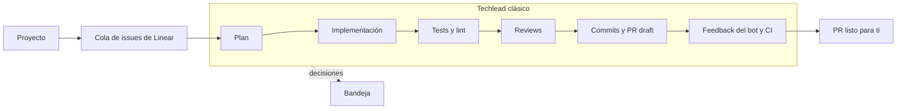

# Clanker Yard

Clanker Yard es una app de escritorio para macOS que toma issues de Linear y las lleva hasta un PR en GitHub con un equipo de agentes (Claude): uno planifica, otro implementa, varios revisan, y el flujo corre los checks, hace los commits, abre el PR y atiende los comentarios del bot de review y de la CI.

Las decisiones que necesitan criterio humano te llegan a una bandeja y solo estacionan su propia corrida: el resto sigue andando. Los agentes actúan como tú en GitHub y Linear, así que lo que publican sale a tu nombre.

## Cómo funciona

Un proyecto junta una cola de issues de Linear con el flujo que las trabaja. El Scheduler toma las issues de la cola y lanza una corrida por cada una, dentro de los cupos de dos carriles (desarrollo y mantenimiento). El flujo incluido, "Techlead clásico", planifica, implementa, corre tests y lint, hace cuatro reviews en paralelo, arma los commits, abre el PR en draft y atiende el feedback del bot de review hasta que la CI queda verde. El resultado es un PR listo para que lo revises tú.



El core (el proceso que corre los flujos) es independiente de la ventana: cerrarla no detiene las corridas. La app, la CLI y el MCP hablan con el mismo core.

## Instalar

Requisitos:

- macOS en Apple Silicon (el build es arm64).
- Node 24 (el repo trae `.nvmrc`) y `git`.
- Claude Code instalado (`claude`) y con sesión iniciada en tu suscripción de Claude: los agentes usan ese login, la app no guarda ninguna credencial de Claude.
- `gh` es opcional: la app habla con GitHub por API y no lo necesita.

```bash
git clone https://github.com/SimonOyaneder/clanker-yard.git
cd clanker-yard
nvm use
npm ci
npm run install:mac
```

`npm run install:mac` construye la app, la copia a `/Applications/Clanker Yard.app`, deja el comando `clanker` en `~/.local/bin/clanker` (un symlink hacia la app) y abre la app. Si ya había una versión corriendo, la reemplaza; para que corra el core nuevo, usa `Archivo > Salir y detener agentes` y vuelve a abrirla. Si `~/.local/bin` no está en tu `PATH`, agrégalo.

La app no está firmada. Como la construyes y la copias tú, macOS normalmente no la bloquea. Si aun así dice que no se puede abrir, haz clic derecho sobre la app en `/Applications`, elige Abrir y confirma una vez; o quita la marca de cuarentena:

```bash
xattr -dr com.apple.quarantine "/Applications/Clanker Yard.app"
```

## Primeros pasos

Al abrir la app sin proyectos ves una bienvenida con los cinco pasos de la configuración; el pie de la barra lateral muestra "Configuración n/5" hasta completarlos, y cada paso lleva a donde se hace.

1. GitHub (en Conexiones): pulsa "Crear token en GitHub", que abre el formulario de un token classic con el scope `repo` ya marcado. Créalo, pégalo en el campo "Personal access token (classic)" y pulsa "Probar". Un token fine-grained no sirve porque no puede leer los checks. La opción "Conectar con la GitHub App" solo aparece si registraste la App y pusiste su `client_id` (`docs/github-app.md`).
2. Linear: pulsa "Conectar con Linear" y autoriza en el navegador. Para otro workspace, "Conectar otro workspace": cada workspace es una cuenta.
3. Claude: pulsa "Probar". Hace una llamada mínima, detecta tu versión y plan y muestra cuánto llevas usado.
4. Repo: en "Repos y recetas" pulsa "Agregar repo" y elige en el Finder la carpeta donde tienes clonado el repo (el checkout local, no la URL de GitHub). Si el repo tiene receta (ver abajo), "Probar receta" la corre en un worktree desechable.
5. Proyecto: pulsa el botón de nuevo proyecto de la barra lateral (`⌘N`, o `Archivo > Nuevo proyecto…`). Elige un nombre, el proyecto de Linear de la lista, el "Flujo por defecto" (Techlead clásico) y el "Perfil por defecto" (qué modelo usa cada agente). El tracker "Local (para probar)" no lee de ningún lado: sus issues se crean por la API.

Después:

1. Correr: en la pestaña Operación del proyecto, la lista "En cola" muestra las issues con su motivo; "Correr" lanza el flujo sobre una. Con el proyecto activo, la app toma la cola sola; "Pausar" y "Reanudar" lo detienen y lo retoman.
2. Seguir el trabajo:
   - Bandeja (`⇧⌘I`): las decisiones que esperan por ti.
   - Learnings (`⇧⌘A`): lo que los agentes proponen recordar; solo lo que apruebas llega a los siguientes.
   - Stacks de PR (`⇧⌘P`): tus PRs abiertos en los repos registrados, agrupados por stack.
   - Flujos: la biblioteca de flujos, roles y perfiles (ver abajo).
   - Ajustes del proyecto (pestaña Ajustes, `⇧⌘3`): repos, proyecto de Linear, filtros de la cola, mapeo de estados, convenciones, parámetros del flujo y exportar o importar su configuración.
   - Ajustes de la app (barra lateral, Configurar > Ajustes): cuántas corridas caben a la vez en cada carril de la máquina, los packs activos, con qué flujo, perfil y paralelismo parte un proyecto nuevo, y la carpeta de datos.

Un proyecto creado antes de que la app listara los proyectos de Linear puede tener guardado un nombre en vez del id: Operación lo avisa con "Elegir el proyecto de Linear", que lleva a elegirlo de nuevo.

`⌘K` abre la paleta de comandos y `⌘/` la lista de atajos.

## Receta del repo

Para que los agentes instalen dependencias y corran tests y lint, el repo necesita `.clanker/recipe.json`. Sin receta las corridas trabajan igual, pero sin checks. Un ejemplo (el de este repo):

```json
{
  "version": 1,
  "requires": [{ "name": "npm", "check": "npm --version" }],
  "setup": { "worktree": ["npm ci --silent"] },
  "commands": {
    "typecheck": "npm run -s typecheck",
    "lint": "npm run -s lint",
    "test:related": "npx vitest related --run --passWithNoTests {{files}}"
  },
  "checks": ["typecheck", "lint", "test:related"]
}
```

`requires` se prueba antes de correr, `setup.worktree` prepara cada worktree nuevo y `checks` corre en orden y se corta en el primer rojo. Un comando con `{{files}}` recibe los archivos que cambió la issue y se salta si no cambió nada. En Conexiones, "Probar receta" la corre en un worktree desechable y muestra el log en vivo.

## Flujos, roles y perfiles

En Flujos están los flujos, roles y perfiles que usa la app. Uno incluido no se edita directo: "Duplicar para editar" crea uno tuyo con el mismo slug, que manda desde ese momento. Un flujo tuyo se edita con "Editar": en un canvas (agregas pasos desde la paleta, los conectas arrastrando de un paso a otro y el panel edita el paso elegido) o como JSON con validación en vivo, y cada vez que guardas queda una versión nueva; las corridas en curso siguen con la versión con que empezaron. Los roles y perfiles se editan con un formulario.

Lo que versionas en el repo viaja con él: el core carga `.clanker/flows/<slug>.json`, `.clanker/roles/<slug>.md` y `.clanker/profiles/<slug>.json` de la branch por defecto al registrar el repo y cada 5 minutos. "Exportar al repo" (en el detalle de uno tuyo) abre un PR en draft con ese archivo, sin tocar tu checkout. La configuración de un proyecto se exporta e importa como JSON desde Ajustes del proyecto > Exportar e importar.

## Conceptos

- **Proyecto:** una cola de issues de un tracker más el flujo, el perfil y los repos con que se trabajan.
- **Corrida:** una ejecución de un flujo sobre una issue (o un PR). Puede estar en curso, estacionada o terminada.
- **Flujo:** un grafo de pasos guardado como JSON, editable en la app.
- **Paso:** un nodo del flujo: un agente, una acción del core sin LLM, un grupo en paralelo, una decisión humana, una espera o un flujo hijo.
- **Rol:** un agente con su prompt, contexto y herramientas (dev, reviewers, committer, triage).
- **Perfil:** el modelo, el esfuerzo y el presupuesto con que corre cada rol.
- **Carril:** un tope de corridas simultáneas de toda la máquina; hay uno de desarrollo y uno de mantenimiento, para que un rebase no espere a una issue larga.
- **Pack:** lo propio de una organización (señales de PR, bot de review, reglas de CI, convenciones, flujos y roles) como JSON. La app no trae ninguno: cada organización tiene el suyo en su propio repo (hay uno de ejemplo en `packages/testkit/fixtures/packs/example`).
- **Decisión (Bandeja):** algo que el flujo no resuelve solo; estaciona únicamente su corrida hasta que respondes.
- **Learnings:** notas que un agente propone para los siguientes; solo las que apruebas llegan a los briefs.

## CLI y MCP

El comando `clanker` habla con el mismo core que la app (lo levanta si no está corriendo):

```bash
clanker status
clanker projects list
clanker runs start <proyecto> <issue> [--flow <slug>]
clanker runs get <id>
clanker events tail [--run <id>] [--project <slug>] [--follow]
```

`clanker` sin argumentos lista todos los comandos. Todo lo que hace la app también se puede hacer desde Claude Code por el MCP:

```bash
claude mcp add -s user clanker -- ~/.local/bin/clanker mcp
```

## Desarrollo

Monorepo con npm workspaces (Node 24, TypeScript estricto):

```
apps/desktop      Electron (main, preload, ventana)
apps/cli          comandos `clanker` sobre la API
packages/api      contrato oRPC, esquemas zod, cliente
packages/core     Store, Flows, Agents, Workspaces, Scheduler, servidor
packages/ui       React + shadcn, vistas
packages/testkit  runtime fake, fixtures, repos git temporales
packs/           packs de fábrica (hoy ninguno)
docs/             diseño y notas de investigación
```

```bash
npm run dev -w apps/desktop   # construye el core y abre Electron
npm run dev -w packages/ui    # solo la UI en el navegador, con datos de ejemplo
npm run typecheck
npm run lint
npm run test:changed          # solo los tests de lo que cambió la branch
npm test                      # sin los tests de integración lentos (vitest.slow.ts)
npm run test:all              # todo; antes de pushear a main
npm run e2e                   # Playwright sobre la app con un core de demo
```

Durante el desarrollo puedes acotar Vitest al archivo o a los módulos afectados; con un filtro corren también los tests lentos que calcen. La CI está pausada: corre solo a mano desde Actions.

```bash
npm test -- packages/testkit/src/pr-restack.test.ts  # un archivo, aunque sea de los lentos
node scripts/changed-tests.ts --dry-run <archivos>    # qué tests corre test:changed para esos archivos
npm run test:slow                                    # solo los lentos
npm test -- --maxWorkers=3                           # suite rápida con menos procesos
```

Antes de tocar código lee [`AGENTS.md`](AGENTS.md): reglas, límites entre paquetes y trampas que el código no dice. El diseño completo está en [`docs/`](docs/) (`docs/design.html`; `python3 scripts/design-section.py <id>` imprime una sección en texto).

## Datos y privacidad

- Todo vive en `~/Library/Application Support/Clanker Yard` (base SQLite, logs, packs).
- Los tokens de GitHub y Linear van en el llavero de macOS; la base guarda solo una referencia y nunca llegan a la interfaz ni a los eventos. Para Claude no se guarda nada: se usa el login del `claude` instalado (o una API key, si la configuras, que también va al llavero).
- Los agentes actúan como tú: los commits, PRs y comentarios salen con tu cuenta de GitHub y tu usuario de Linear.

## Problemas comunes

- **GitHub dice que al token le falta un permiso:** el token necesita el scope `repo` y debe ser classic. En la tarjeta de GitHub, "Crear token con los permisos marcados" (menú de la tarjeta) abre el formulario ya marcado; pega el nuevo y pulsa "Probar".
- **Linear tiene varias cuentas:** cada workspace es una conexión. En el selector de proyecto de Linear aparecen los de todas las cuentas conectadas, con el nombre del workspace al lado cuando son más de una; elige el de la cuenta correcta.
- **Un repo no aparece en Stacks de PR:** Watch solo busca los PRs abiertos por ti en los repos registrados. Regístralo en Conexiones con "Agregar repo".
- **Un pack no aparece:** se instala desde Ajustes > Packs con la ruta de su carpeta (la que tiene `pack.json`); si está roto, el error dice qué archivo y campo fallan.
- **Un proyecto pide elegir su proyecto de Linear:** es un proyecto viejo que guardó el nombre en vez del id. "Elegir el proyecto de Linear" abre Ajustes del proyecto en "Proyecto del tracker".
- **"El core está caído":** el banner de arriba ofrece "Reintentar" y "Ver logs" (también en `Archivo > Ver logs del core`).
